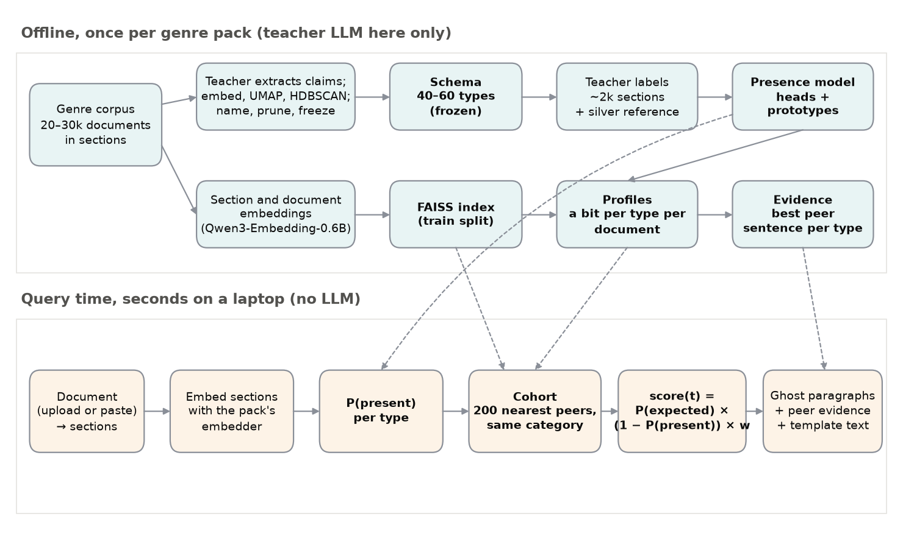
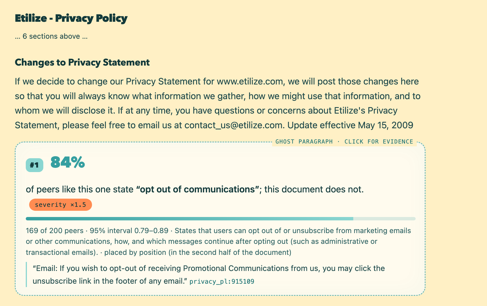
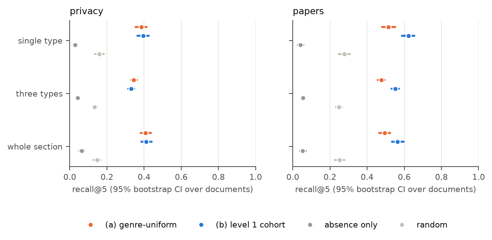
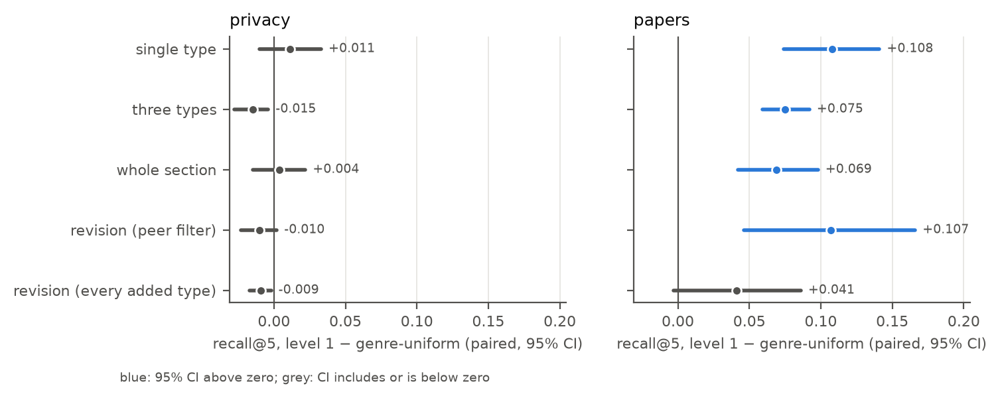
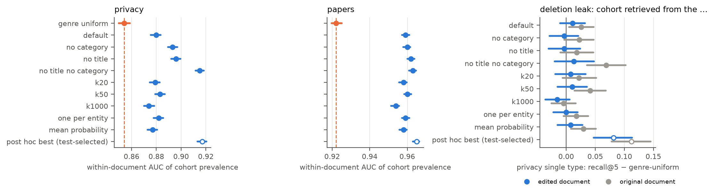
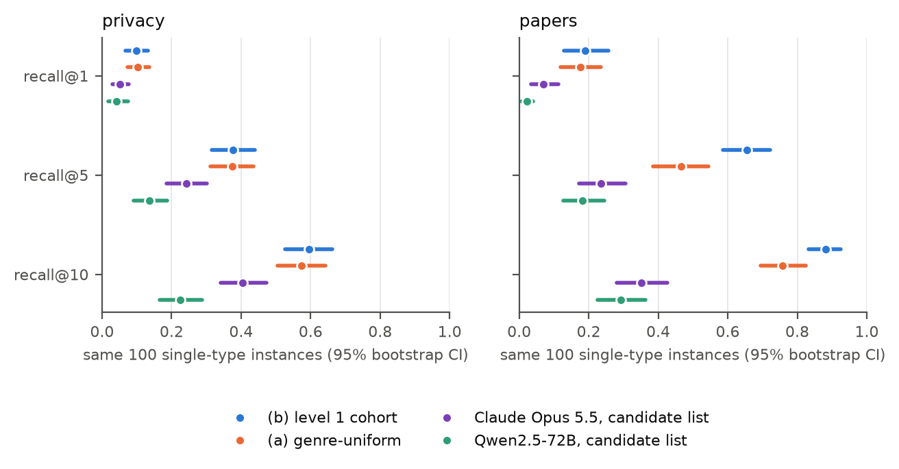

# Negative-Space Reader: detecting what a document conspicuously omits by modelling what its peers assert

Parsa Hosseini · MAAI 902 (NLP Solution Design), Assessment 2 · University of Wollongong in Dubai · October 2026

Demo: https://huggingface.co/spaces/parsa-hke/negative-space-reader

Code: https://github.com/parsa-hke/negative-space-reader

<!-- Every result number in this report is filled from reports/tables/report_fragments/values.json by key (the HTML
     comment after each sentence that carries one names the keys); the tables are the fragments written by
     analysis/tables.py. Nothing numeric was typed by hand. Configuration facts (k = 200, 58 types, 300 reference
     sections, ...) come from the plan and the pack files. -->

## Abstract

We define conspicuous omission as a ranking task: given a document and a corpus of its genre peers, rank the kinds of statement it lacks by how strongly peers like it would be expected to make them, with the peers' own sentences as evidence. One pipeline builds it for privacy policies and computer-science papers; two label-free benchmarks, controlled deletion and the authors' own later revisions, score it. Peers beat genre-wide frequency for papers and not for policies, and we show why: a deletion moves a document towards the peers that omit the same thing. Two frontier chat models given the same catalogue fall well behind both corpus baselines. The demo reports prevalence with evidence, never a verdict.

## 1. Introduction: absence as a signal

A building inspector walks into a house and notices, without a checklist, that the hallway has no smoke alarm. Nothing on the ceiling told them so; the memory of every other hallway did. An absence becomes visible only against an expectation, and the expectation is borrowed from peers.

Documents have the same property, and our tools do not. A privacy policy that never says how long it keeps data, or a paper that never reports variance across runs, contains no sentence to search for, embed or classify; what is missing is a property of the document and its peers together. A large language model seems to carry those peers in its weights, yet Section 7 shows two capable chat models, asked which statements a document lacks, falling well behind the simplest corpus statistic, in line with work on negation [1, 2] and on retrieval [3]: a model trained to predict the next token learns what is present, and an absence leaves no token to predict.

This report describes Negative-Space Reader, which models what a document's genre peers assert. Its research question has three parts: can conspicuous omission be formalised as a ranking task with a label-free evaluation; does an expectation conditioned on the document beat a genre-wide prevalence; and how far behind are frontier chat models at the same task? Peers encode what the dominant authors of a genre do, including their habits of saying too little, so the system never calls a document deficient: it reports what share of similar documents state something, and shows their sentences.

## 2. The task, and what a score may mean

A report needs a scale. A genre pack holds a corpus *C* and a frozen catalogue *T* of assertion types ("states a retention period", "reports computational cost"); a presence detector gives a document *d* a probability per type, and every absent type *t* is scored

score(*t*) = P(*t* expected | *d*, *C*) × (1 − P(*t* present in *d*)) × *w*(*t*),

returning the top ten with their peer counts, up to five peer sentences and a template explanation.

The first factor is the whole idea. The neighbourhood is the cohort, the *k* = 200 indexed documents nearest to *d* in embedding space, same category where the genre has one, never another version of *d*; the expectation, which we call level 1, is the share of the cohort that states *t*, with a Wilson interval [4], and its baseline is the genre-wide prevalence of *t*. The second factor discounts types the detector half-sees; on its own it ranks barely above random (the absence-only rows of Table 4), so in practice it filters out what the document already states and the cohort does the ranking. The third is a severity weight, 1 by default and 1.5 for a few privacy types tied to GDPR or CCPA obligations; the demo applies it and shows a badge (Figure 2), while the benchmarks rank with *w* = 1 and report the weighted ranking as an ablation.

A neighbourhood is a description, not a standard: if most policies in a category say nothing about retention, the cohort will not expect it; the score ranks, it does not judge. Hence the wording rule, fixed before any result was seen: "*N* per cent of peers like this one state *X*; this document does not", never "non-compliant", never "deficient". A second level, a masked-assertion model conditioned on the types the document already states rather than on an embedding of its text, is future work (Section 10).

## 3. Data

A neighbourhood needs a census. Three corpora supply it, each with the version history the real-omission benchmark needs [5, 6, 7].

What a document looks like here: a privacy policy is one web page of a few thousand characters under a handful of headings (median 7 sections, 5,791 characters); a paper is the body text of an arXiv preprint, abstract to conclusion (median 19 sections, 28,914 characters). <!-- values: corpus/*/sections_per_doc_median, corpus/*/chars_per_doc_median -->

**Privacy policies** come from the Princeton–Leuven Longitudinal Corpus [5], about a million Wayback Machine snapshots of 130 thousand sites' policies, mostly the same policies repeated, so we keep one snapshot per site per year, stratified by year and category, with every site's full version chain. OPP-115 [6], 115 policies hand-annotated with ten data-practice categories, checks our models and never trains them. **Research papers** come from the open subset of unarXive 2022 [7], primary category cs.CL or cs.LG with a first version from 2018 on; earlier versions of the test papers are fetched as arXiv e-prints and parsed with the same loader.

A heading-aware segmenter cuts policies into sections, with paragraph chunks as the fallback; sections under 80 characters are dropped, sections over 8,000 are split on paragraph breaks, boilerplate lines are removed by rule, and a round-trip test asserts that segmentation loses no body text. The embedder reads at most 1,024 tokens of a section, so the tail of a very long section goes unseen; how often that happens was not measured. MinHash finds near-duplicates, collapsed into version chains; splits are disjoint by entity and sealed with a hash; every entity with a revision pair is in the test split, and no version of it is ever indexed (Table 1).

<!-- include: corpus.md -->

<!-- generated by analysis/tables.py from corpus_stats.csv, dedup.csv, revisions.csv; do not edit -->
|  | privacy policies | research papers |
|---|---|---|
| documents (indexed train / dev / test) | 28,440 (22,300 / 3,043 / 3,097) | 17,644 (14,114 / 1,784 / 1,746) |
| distinct entities (sites or arXiv ids) | 23,310 | 17,644 |
| sections per document (median) | 7 | 19 |
| sentences per section (mean) | 8.1 | 13.9 |
| characters per document (median) | 5,791 | 28,914 |
| dates | 1998-07 to 2019-12 | 2018-01 to 2022-12 |
| near-duplicate rate in the sample | 18.6% | 0.3% |
| documents dropped as cross-split twins | 1,949 | 37 |
| revision pairs (test entities) | 4,029 | 343 |
| largest categories (documents) | education 5,149, business 4,945, shopping 3,944, informationtech 3,650, entertainment 2,392 | cs.LG 10,655, cs.CL 6,989 |

*Table 1. Corpus statistics (train is the indexed corpus; dev holds calibration and labelling samples; test is never indexed).*

Two findings shaped later phases: 18.6% of sampled policies are near-duplicates of another (many sites reuse one template), so 1,949 near-copies of test documents were dropped from train and dev; <!-- values: corpus/privacy/near_duplicate_rate, corpus/privacy/cross_split_dropped --> and the open subset holds only 17,644 permissively licensed papers in scope, below the twenty to thirty thousand the plan asked for, recorded as a negative finding rather than widening the licence filter. <!-- values: corpus/papers/documents -->

The yearly snapshots suggest a shortcut, comparing a site's policy with its own earlier pages; but a site's earlier self says nothing about what the street expects, so cohort retrieval excludes the query's own entity, and in the revision benchmark the chain supplies the label and the street the expectation.

## 4. Architecture

The system is five steps, none of which asks a language model to guess at query time, in the lean tier that runs on a laptop and a free host; each component has a larger alternative behind one configuration key (Figure 1). A written plan, kept in the repository, fixed every design decision and every pass-or-fail gate before the experiments, and seven decision records log where the build departed from it; this report names each gate by what it tests.

*Figure 1. The architecture: the offline pack build (top) and the query-time path (bottom), which calls no language model.*

**A genre is a pack.** The engine contains no genre-specific code. A pack bundles corpus, schema, presence model, prototypes, index and configuration, and adding a genre means running the pack builder, as a console plays whatever cartridge is inserted.

**Schema induction.** An open teacher model reads a stratified sample of development documents and extracts each section's assertions as short claims with verbatim spans, phrased as the *move* the document makes ("the authors report variance over seeds") rather than its subject. Claims are embedded with Qwen3-Embedding-0.6B [8] under an instruction asking for the kind of statement, centred on their document's mean so that topic drops out, reduced with UMAP [9] and clustered with HDBSCAN [10, 11]. The larger teacher names each cluster; a single reviewer merges, splits and prunes against seeds (OPP-115's categories; the NeurIPS and ACL checklists [12, 13]); a coverage check on held-out sections found almost no statement without a type. Privacy has 58 types, papers 47.

**Presence detection** combines two cheap signals per section and type through a learned logistic layer: one calibrated logistic head per type over the frozen section embedding, and the maximum late-interaction similarity between the section's sentences and ten to thirty prototype sentences per type, computed ColBERT-style [14] with a small Apache-licensed model [15, 16]. We added a cross-encoder reranker [17] for a borderline band; it added a few thousandths of macro-F1 at five to nine times the time, so it stays implemented, ablated and off. A small model fitted on whole labelled documents aggregates section probabilities to the document (Section 5).

**Cohort, ranking and evidence.** A document's vector is the mean of its section vectors blended with a title-and-abstract vector; the index is FAISS [18]. Each indexed document carries a profile, a bit per type, and the expectation for an absent type is the cohort's mean bit. Evidence is each peer's best sentence per type, precomputed over the index. The stack is PyTorch, transformers and sentence-transformers [19, 20], with every experiment run from one entry point and logged.

**What the user gets, and who.** The user is a reviewer with a document and a question: a compliance officer reading a vendor's policy before signing, an area chair checking a submission's reporting, an author self-checking before release. They get the document back from a Gradio app [21] in seconds, with ghost paragraphs between its sections, one for each kind of statement that its 200 closest peers state most often and it does not, placed where peers say it, with the count, the interval and a peer's sentence (Figure 2); a click opens the evidence. The decision it supports is where to look first, not whether to sign or accept. A wrong ghost therefore costs a minute spent reading the peers' sentences and dismissing it; a missed omission costs what it always did, which is why the output is a ranked list with counts rather than a verdict.

*Figure 2. The demo's document panel on a test-split policy: the first ghost paragraph, placed where peers state what this document does not, with the count, the interval and a peer's sentence.*

## 5. Model selection and tuning

Three decisions departed from the plan; each has a decision record.

**The teacher.** The plan named Qwen2.5-72B-Instruct [22] on the university GPU server, which turned out to be a workstation with four 32 GB GPUs and a day-long session, too slow for the 72B. We chose the plan's named fallback, the 32B of the same family at four-bit quantisation under llama.cpp [23], confirmed the extraction prompt by eye on it, and used the 72B through a pinned, cached API route to name the clusters and label presence.

**The reference, and what a gate can measure.** The plan's hand-labelled reference set did not fit the schedule, so the reference became silver: the same 300 fixed sections per genre labelled by a second model of another family, Claude Haiku 5.5, with the teacher's own two-pass prompts (Table 2).

<!-- include: agreement.md -->

<!-- generated by analysis/tables.py from teacher_vs_judge_privacy.csv, teacher_vs_judge_v2_papers.csv, teacher_vs_opp115_reference_privacy.csv, teacher_vs_opp115_judge_privacy.csv; do not edit -->
**Label agreement on the reference sections** (micro precision, recall and F1 pooled over types from the per-type counts):

| genre | comparison | sections | micro P | micro R | micro F1 |
|---|---|---|---|---|---|
| privacy policies | teacher vs judge, 58 types | 300 | 0.740 | 0.814 | 0.775 |
| research papers | teacher vs judge, 47 types (pack v2) | 300 | 0.673 | 0.711 | 0.692 |
| privacy policies | teacher vs OPP-115 human labels, 35 mapped types | 300 | 0.606 | 0.586 | 0.596 |
| privacy policies | judge vs OPP-115 human labels, 35 mapped types | 300 | 0.657 | 0.577 | 0.614 |

*Table 2. Agreement between labellers on the reference sections.*

Teacher and judge agree at micro-F1 0.775 on policies and 0.692 on papers, while either model agrees with OPP-115's human labels at about 0.596, whose scheme, mapped onto ours, is often narrower or broader than our definitions. <!-- values: agreement/* --> A student trained on the master's answers cannot agree with a third examiner more than the master does, so the plan's gate of macro-F1 0.80 was unreachable by construction and became relative, 80 per cent of the teacher's own macro-F1 against the same reference, with heads trained on teacher labels.

**The presence model.** Each head is a class-weighted logistic regression over the section embedding, regularisation and threshold chosen on the fitting half of the reference, with a temperature per type [24]; expected calibration error (ECE) [25] is reported because later stages use P(present) as a probability (Table 3; the section-level variants are in Appendix A, Table 13).

<!-- include: presence.md -->

<!-- generated by analysis/tables.py from presence_gate.csv, doc_presence_<genre>.csv; do not edit -->
**The presence gate** (macro-F1 at or above 80 per cent of the teacher's own macro-F1 against the same silver reference):

| genre | presence model | macro-F1 | teacher ceiling | share of ceiling | gate | documents profiled | sections / s |
|---|---|---|---|---|---|---|---|
| privacy policies | classifier + prototypes | 0.619 | 0.773 | 0.801 (gate ≥ 0.80) | pass | 22,300 of 22,300 | 134 (mps) |
| research papers | classifier + prototypes | 0.497 | 0.688 | 0.722 (gate ≥ 0.80) | not met | 14,114 of 14,114 | 65 (mps) |

**Document level** (evaluation half, 75 whole labelled documents per genre, against the judge):

| genre | aggregation | macro-F1 | micro-F1 | ECE | prevalence error | types per document |
|---|---|---|---|---|---|---|
| privacy policies | best section ≥ section threshold (v1) | 0.687 | 0.739 | 0.150 | 0.136 | 22.8 (labelled 26.8) |
| privacy policies | document model (v2) | 0.754 | 0.808 | 0.018 | 0.063 | 26.1 (labelled 26.8) |
| research papers | best section ≥ section threshold (v1) | 0.734 | 0.789 | 0.217 | 0.152 | 25.9 (labelled 27.8) |
| research papers | document model (v2) | 0.788 | 0.850 | 0.020 | 0.094 | 29.7 (labelled 27.8) |

*Table 3. Presence detection: the gate, and document-level aggregation.*

Three things stand out. Prototypes alone are weak, but next to the classifier they cut ECE from 0.061 to 0.003 on policies. <!-- values: presence/privacy/classifier only/ece, presence/privacy/classifier + prototypes/ece --> The gate passes for policies at 0.801 of the ceiling and is not met for papers at 0.722: a frozen whole-section embedding cannot separate 47 fine-grained types in long sections that carry about five each. <!-- values: presence/*/gate/share_of_ceiling --> The gate was recorded as not met and the remedy, fine-tuning the embedder, is recorded but not attempted, so the papers pack ships below its specification. Aggregating by "any section above its threshold" was miscalibrated in both directions; a logistic model over the best section probabilities and the section count, fitted on 150 whole judge-labelled documents per genre, raised document-level macro-F1 from 0.687 to 0.754 on policies and from 0.734 to 0.788 on papers, and cut ECE to 0.018 and 0.020. <!-- values: doc_presence/* -->

The cohort settings were fixed in the plan and selected on no benchmark; nothing was selected on the test split.

## 6. Evaluation I: OmitBench, and the privacy turn

**OmitBench-synthetic** removes a piece we can check. From each held-out test document we draw a type it states, delete the sentences that carry it, verify that it is now absent, and ask each system to rank the absences; three regimes delete one type, three types or every section carrying the type, 500 instances per regime and genre, except that long papers resist three-type deletion and gave 468. <!-- values: synth/papers/three_types/n --> Metrics are recall at 1, 5 and 10, MRR and nDCG@10 with 95 per cent bootstrap intervals [26], plus false alarms and calibration on 150 untouched judge-labelled documents (Table 4, Figure 3; the other metrics and the untouched-document checks are in Appendix A, Table 11).

<!-- include: synth.md -->

<!-- generated by analysis/tables.py from bench_synth_<genre>.csv; do not edit -->
**Recall@5 on OmitBench-synthetic** (500 instances per regime and genre unless stated; 95% bootstrap CI over documents):

| regime | system | privacy policies | research papers |
|---|---|---|---|
| one type | (a) genre-uniform prevalence | 0.385 [0.353, 0.414] | 0.514 [0.481, 0.552] |
|  | (b) level-1 cohort prevalence | 0.396 [0.363, 0.425] | 0.622 [0.587, 0.655] |
|  | random order | 0.159 [0.138, 0.182] | 0.278 [0.249, 0.308] |
|  | absence only (1 − P(present)) | 0.028 [0.019, 0.038] | 0.042 [0.028, 0.057] |
| three types | (a) genre-uniform prevalence | 0.345 [0.330, 0.362] | 0.476 [0.457, 0.494] (n = 468) |
|  | (b) level-1 cohort prevalence | 0.330 [0.314, 0.347] | 0.552 [0.532, 0.572] (n = 468) |
|  | random order | 0.134 [0.123, 0.146] | 0.248 [0.233, 0.263] (n = 468) |
|  | absence only (1 − P(present)) | 0.042 [0.035, 0.048] | 0.055 [0.046, 0.065] (n = 468) |
| whole section | (a) genre-uniform prevalence | 0.408 [0.382, 0.436] | 0.495 [0.465, 0.525] |
|  | (b) level-1 cohort prevalence | 0.412 [0.386, 0.440] | 0.564 [0.533, 0.596] |
|  | random order | 0.146 [0.128, 0.165] | 0.252 [0.226, 0.278] |
|  | absence only (1 − P(present)) | 0.064 [0.051, 0.078] | 0.053 [0.039, 0.070] |

*Table 4. OmitBench-synthetic, recall@5.*

*Figure 3. Recall@5 per regime and system, both genres, with 95 per cent bootstrap intervals; reference rows in grey.*

Both systems sit far above random order; whether the cohort beats genre-wide prevalence outside the paired interval is the cohort gate (Table 5, Figure 4).

<!-- include: gate66.md -->

<!-- generated by analysis/tables.py from bench_synth_<genre>.csv, bench_revision_<genre>.csv; do not edit -->
**Recall@5, level 1 − genre-uniform** (paired bootstrap, 95% CI; ✓ above zero, ✗ below; the cohort gate is the one-type row):

| benchmark, regime | privacy policies | research papers |
|---|---|---|
| one type | +0.011 [-0.010, +0.033] (n = 500) | +0.108 [+0.074, +0.141] ✓ (n = 500) |
| three types | -0.015 [-0.028, -0.004] ✗ (n = 500) | +0.075 [+0.059, +0.092] ✓ (n = 468) |
| whole section | +0.004 [-0.015, +0.022] (n = 500) | +0.069 [+0.042, +0.098] ✓ (n = 500) |
| revision (peer filter) | -0.010 [-0.023, +0.002] (n = 1678) | +0.107 [+0.046, +0.166] ✓ (n = 137) |
| revision (every added type) | -0.009 [-0.017, -0.002] ✗ (n = 2672) | +0.041 [-0.003, +0.086] (n = 226) |

*Table 5. The gate quantity across benchmarks.*

*Figure 4. Paired recall@5 difference, level 1 minus genre-uniform; blue where the interval excludes zero.*

**OmitBench-revision** treats the authors' own later addition as a confession: if version *n*+1 adds a type that at least half of the peers dated before version *n* already stated, version *n* conspicuously omitted it, with expectation computed against the time-windowed cohort (Table 6).

<!-- include: revision.md -->

<!-- generated by analysis/tables.py from revision_bench_<genre>.csv, bench_revision_<genre>.csv; do not edit -->
**From version pairs to instances** (a pair qualifies when a type added in version n+1 was stated by at least half of the peers dated before version n):

| genre | pairs | no added type | no added type at ≥ 0.5 prevalence | instances (peer filter) | instances (every added type) | years |
|---|---|---|---|---|---|---|
| privacy policies | 4,029 | 1,357 | 994 | 1,678 | 2,672 | 1999–2019 |
| research papers | 343 | 117 | 89 | 137 | 226 | 2019–2022 |

**Recall@5 on OmitBench-revision** (time-windowed cohorts; genre-uniform uses the prevalence of the same date window; bootstrap over entities):

| variant | system | privacy policies | research papers |
|---|---|---|---|
| revision (peer filter) | (a) genre-uniform prevalence | 0.602 [0.580, 0.625] | 0.674 [0.611, 0.739] |
|  | (b) level-1 cohort prevalence | 0.592 [0.568, 0.614] | 0.781 [0.722, 0.838] |
|  | random order | 0.147 [0.133, 0.161] | 0.343 [0.271, 0.409] |
|  | absence only (1 − P(present)) | 0.007 [0.004, 0.012] | 0.016 [0.000, 0.038] |
| revision (every added type) | (a) genre-uniform prevalence | 0.290 [0.278, 0.303] | 0.474 [0.430, 0.522] |
|  | (b) level-1 cohort prevalence | 0.281 [0.268, 0.293] | 0.516 [0.471, 0.559] |
|  | random order | 0.170 [0.160, 0.180] | 0.301 [0.257, 0.346] |
|  | absence only (1 − P(present)) | 0.045 [0.040, 0.052] | 0.208 [0.170, 0.250] |

*Table 6. OmitBench-revision.*

For papers the cohort passes the gate on every regime, by +0.108 on the one-type regime and +0.107 on real revisions, intervals above zero. <!-- values: gate66/papers/single_type, gate66/papers/revision --> For policies it wins nowhere: +0.011 [-0.010, +0.033] on the gate regime, and small negative differences elsewhere. <!-- values: gate66/privacy/single_type -->

**The diagnosis.** Per cohort variant we measured how well cohort prevalence predicts which types an untouched document states (a within-document AUC, 800 test documents), and recall@5 with the cohort retrieved from the edited document's vector, what the system sees, against the original's, what it would see if the deletion left no trace (Table 7, Figure 5; every variant in Appendix A, Table 12).

<!-- include: leak.md -->

<!-- generated by analysis/tables.py from cohort_diagnosis_<genre>.csv; do not edit -->
**Cohort diagnosis, the default cohort** (within-document AUC on untouched test documents; one-type recall@5 gain over genre-uniform from the edited and from the original document; the leak is their difference):

| genre | AUC, genre-uniform | AUC, default cohort | edited − uniform | original − uniform | leak (original − edited) |
|---|---|---|---|---|---|
| privacy policies | 0.854 | 0.880 [0.875, 0.883] | +0.011 [-0.011, +0.033] | +0.026 [+0.005, +0.047] | +0.015 [+0.005, +0.026] |
| research papers | 0.922 | 0.959 [0.957, 0.961] | +0.108 [+0.075, +0.142] | +0.117 [+0.085, +0.149] | +0.009 [-0.001, +0.019] |

*Table 7. Cohort diagnosis, the default cohort against genre-wide prevalence.*

*Figure 5. Within-document AUC per cohort variant and, for privacy, the deletion leak: gain over genre-uniform with the cohort retrieved from the edited versus the original document.*

Privacy cohorts carry little information about practices: against genre prevalence the default cohort raises within-document AUC from 0.854 to 0.880, against 0.922 to 0.959 for papers. <!-- values: leak/*/genre_uniform/within_doc_auc, leak/*/default/within_doc_auc --> Two plan settings, the site category and the title part of the vector, weaken them further; without both, AUC reaches 0.915. <!-- values: leak/privacy/no_title_no_category/within_doc_auc --> The main cause: the deletion leaks into the cohort. A policy that loses a topic moves towards the policies that never had it, so the deleted type's cohort prevalence drops exactly where it is needed. With the better cohort, the original vector would give +0.069 [+0.036, +0.102] over genre-uniform; the edited vector gives +0.013, and the leak, +0.056, takes most of the gain away. <!-- values: leak/privacy/no_title_no_category/* --> Papers are shielded by their title and abstract, which no deletion touches; their leak at the default is +0.009. <!-- values: leak/papers/default/leak_original_minus_edited -->

A real omitter also resembles other omitters, and the revision benchmark, where nothing was deleted, shows the same sign for policies (Table 5). The leak is a property of the task, and it points at level 2: an expectation conditioned on what the document states cannot be moved by the absence it is asked to find.

A search over eleven cohort settings on the test bench finds a variant that would pass the privacy gate; we did not adopt it, since it was selected on test data, and it is recorded as post hoc and excluded from every table here.

## 7. Evaluation II: the frontier gap, speed and errors

Could a chat model have done this without a corpus? In the candidate-list setting the model reads one document and the genre's catalogue with definitions, and returns the ten types it judges most conspicuously absent; the prompt never mentions that text was removed. We ran Claude Opus 5.5 (batch mode, moderate reasoning) and the open teacher Qwen2.5-72B-Instruct (pinned provider), each once, on the same 100 one-type instances per genre, paired against the corpus systems (Table 8, Figure 6). <!-- values: llm_gap/n -->

<!-- include: llm_gap.md -->

<!-- generated by analysis/tables.py from llm_gap_candidate_<genre>.csv; do not edit -->
**Candidate-list setting, the same 100 one-type instances per genre** (MRR cut at 10 for every system; 95% bootstrap CIs):

| system | metric | privacy policies | research papers |
|---|---|---|---|
| Claude Opus 5.5 (candidate list) | recall@1 | 0.051 [0.029, 0.077] | 0.070 [0.035, 0.113] |
|  | recall@5 | 0.242 [0.185, 0.301] | 0.235 [0.172, 0.306] |
|  | recall@10 | 0.405 [0.341, 0.474] | 0.352 [0.281, 0.427] |
|  | mrr@10 | 0.339 [0.272, 0.405] | 0.275 [0.208, 0.353] |
| Qwen2.5-72B-Instruct (candidate list) | recall@1 | 0.042 [0.018, 0.075] | 0.022 [0.007, 0.040] |
|  | recall@5 | 0.137 [0.090, 0.187] | 0.181 [0.126, 0.245] |
|  | recall@10 | 0.225 [0.165, 0.287] | 0.293 [0.226, 0.363] |
|  | mrr@10 | 0.199 [0.140, 0.266] | 0.179 [0.127, 0.235] |
| (b) level-1 cohort prevalence | recall@1 | 0.098 [0.068, 0.132] | 0.189 [0.128, 0.256] |
|  | recall@5 | 0.376 [0.316, 0.439] | 0.655 [0.586, 0.723] |
|  | recall@10 | 0.596 [0.526, 0.663] | 0.882 [0.833, 0.925] |
|  | mrr@10 | 0.451 [0.374, 0.525] | 0.545 [0.477, 0.614] |
| (a) genre-uniform prevalence | recall@1 | 0.103 [0.074, 0.136] | 0.177 [0.118, 0.236] |
|  | recall@5 | 0.375 [0.312, 0.435] | 0.465 [0.385, 0.544] |
|  | recall@10 | 0.573 [0.504, 0.643] | 0.758 [0.694, 0.824] |
|  | mrr@10 | 0.484 [0.412, 0.561] | 0.480 [0.407, 0.555] |

**Paired differences in recall@5** (chat model − corpus system):

| difference | privacy policies | research papers |
|---|---|---|
| Claude Opus 5.5 − level-1 cohort prevalence | -0.133 [-0.198, -0.064] | -0.420 [-0.518, -0.325] |
| Claude Opus 5.5 − genre-uniform prevalence | -0.132 [-0.199, -0.061] | -0.230 [-0.328, -0.129] |
| Qwen2.5-72B-Instruct − level-1 cohort prevalence | -0.239 [-0.311, -0.160] | -0.473 [-0.569, -0.378] |
| Qwen2.5-72B-Instruct − genre-uniform prevalence | -0.238 [-0.304, -0.166] | -0.283 [-0.387, -0.182] |

*Table 8. The frontier comparison.*

*Figure 6. Recall@1, 5 and 10 of the four systems on the same instances.*

Opus reaches recall@5 of 0.242 on policies and 0.235 on papers, against 0.376 and 0.655 for the cohort and 0.375 and 0.465 for genre-wide prevalence; every paired difference has an interval that excludes zero. <!-- values: llm_gap/*/recall@5 --> The open model is further behind: most of its lists follow the catalogue's own order, so it filters rather than ranks.

Two caveats: the yardstick is our own detector, so a chat model that reads a paraphrase we left behind as stated is marked wrong; and each model ran once, at one setting.

**Speed.** The whole pipeline runs in seconds on a laptop (Apple M5, MPS; Table 9), embedding being most of the time; on the demo's free two-core host a policy takes roughly ten seconds and a paper about half a minute.

<!-- include: speed.md -->

<!-- generated by analysis/tables.py from analyse_gate_<genre>.csv; do not edit -->
**End-to-end time per held-out document** (template explanations, after one warm-up call; the machine is named in the text):

| genre | documents | sections | median s | max s | embedding share of time |
|---|---|---|---|---|---|
| privacy policies | 5 | 4–17 | 0.35 | 1.37 | 78% |
| research papers | 5 | 13–31 | 3.11 | 3.28 | 86% |

*Table 9. End-to-end time per document on the laptop.*

**Errors.** The types the cohort never finds are the rare ones: 13 of 58 privacy types never reach the top five, with a median corpus prevalence of 0.100 against 0.384 for all scored types; a prevalence ranker cannot rank what few peers state. <!-- values: errors/privacy/* --> The recurring false alarms are types stated in unusual words, which the detector half-sees. The cohort's gain grows with length for papers, from +0.071 in the shortest quartile to +0.187 in the third, while for policies only the shortest quartile shows a gain with an interval above zero, +0.042. <!-- values: errors/*/by_length/* -->

## 8. Related work

Automated reading of privacy policies runs from the OPP-115 corpus [6] to Polisis [27], which classifies policy segments into data practices, and the longitudinal corpus we build on was created to study how policies changed around the GDPR [5]; all of it reads what a policy says, and the contribution here is the complement. For papers the nearest neighbours are the reporting checklists venues now require [28, 12, 13] and the studies of what they achieve [29]; a checklist is a hand-written catalogue of expected statements, and schema induction can be read as learning one from the genre. That language models are poor at negation and absence is established for understanding tasks [1, 2] and for retrieval [3]; Section 7 adds a document-level instance. The planned level-2 model is a set transformer over present types [30].

## 9. Limitations and responsible use

**Prevalence describes a community; it is not a standard.** A share of peers encodes what the dominant actors of a genre do, including their habits of saying too little. Every output is therefore a prevalence with evidence attached, never a verdict.

**The catalogue carries the teacher's eye, and the reference is silver.** A kind of statement the teacher does not notice cannot become a type, and every presence number measures agreement between two models; OPP-115 is the one human check, for privacy and a subset of types. The teacher also decided what counts as a statement, and the severity weights follow its reading of GDPR and CCPA; neither was probed against a person. Corpora, prompts and catalogues are English only.

**A deletion is not an omission, and the benchmark shares our detector.** The synthetic benchmark favours the corpus systems in the frontier comparison, and the deletion leaks into the cohort. Section 6 argued that real omissions leak the same way, but that rests on the revision benchmark, not yet validated by people: until the 50-document, two-annotator check, the revision labels carry two unquantified confounds, regulation-driven additions and authors' own drift.

**Small models, one pass, two genres.** The papers detector is below its gate, so presence misses become omission false alarms; the chat models ran once each; the open-ended and retrieval-augmented baselines, the masked-assertion model and a third genre are future work.

**Dual use.** A detector of conspicuous absence is also a map of what a document can leave out unnoticed: an author could tune a text until the ghost paragraphs disappear while the substance stays missing.

Table 10 sets each risk against its mitigation.

| risk | mitigation in place | still open |
|---|---|---|
| a count read as a standard | the wording rule ("N% of peers like this one state X"), evidence beside every number, no verdict word in the interface (tested) | a reader may still take a prevalence for a norm |
| norms that encode dominant actors | the cohort is shown with its k, category and date window and can be re-cut; prevalence is reported, never compliance | a cohort of 200 holds about 177 distinct sites, or 200 papers (Appendix A, Table 14), but no measure of which actors dominate it |
| the teacher's eye and a silver reference | OPP-115 as a human check for privacy; the gate relative to the teacher; the limits stated with every number | human validation of the revision labels, a human check for papers |
| dual use: tuning a text until the ghosts disappear | every claim is a quote from a peer, visible to the reader; the catalogue ships with the demo | none beyond the reader |
| the privacy of uploaded documents | processed in memory, never stored; no API call on the query path; teacher explanations off by default and flagged | none |
| third-party text in the corpora and the demo | licences recorded before use; short attributed quotes; the non-commercial OPP-115 is a check, not training data | the product layer needs a licence or a swap |

*Table 10. Risks, the mitigation in place, and what remains open.*

## 10. Conclusion

Conspicuous omission is now a ranking task with a frozen catalogue per genre, a score that multiplies expectation by absence, and two label-free benchmarks, built for two genres from one pipeline with no genre code. Conditioning expectation on the nearest peers beats genre-wide prevalence for research papers on every regime and on real revisions, and does not for privacy policies, where the cohort carries little information about practices and the absence itself moves the document towards peers that share it; we reported that failure as a finding and kept the settings the plan fixed. Two frontier chat models given the same catalogue fall well behind both corpus baselines, within the caveats of Section 7.

What comes next follows from what failed: the masked-assertion model conditions expectation on the statements a document makes, so the absence it is asked to find cannot move it; the revision labels need human validation; and a third genre would test the pack abstraction. The demo is live, and the repository holds the configurations, prompts and run log needed to produce every number here again.

## GenAI acknowledgement

<!-- Plan 7.5. The short form, as Parsa asked (2026-10-25): the practice is recorded in CLAUDE.md and the run log. -->

Generative AI was used as an assistant throughout this project, to work faster rather than to replace the work: Claude Code (Anthropic) helped write and test code, run the recorded experiments, keep the changelog, and edit this report, under rules kept in the repository. The research question, the design decisions, the review of every result, the human pass over both schemas and the final text are the author's own. Language models are also part of the system under study (Qwen2.5 for schema induction and presence labels, Claude Haiku 5.5 as the second judge, Claude Opus 5.5 and Qwen2.5-72B as the compared chat models); every prompt is versioned in the repository and every number in this report comes from the result tables.

## References

[1] T. H. Truong, T. Baldwin, K. Verspoor, and T. Cohn, "Language models are not naysayers: An analysis of language models on negation benchmarks," in *Proc. 12th Joint Conf. on Lexical and Computational Semantics (\*SEM 2023)*, Toronto, Canada, 2023, pp. 101–114, doi: 10.18653/v1/2023.starsem-1.10.
[2] M. M. Hossain, D. Chinnappa, and E. Blanco, "An analysis of negation in natural language understanding corpora," in *Proc. 60th Annu. Meeting of the Association for Computational Linguistics (Short Papers)*, Dublin, Ireland, 2022, pp. 716–723, doi: 10.18653/v1/2022.acl-short.81.
[3] O. Weller, D. Lawrie, and B. Van Durme, "NevIR: Negation in neural information retrieval," in *Proc. 18th Conf. of the European Chapter of the Association for Computational Linguistics (Long Papers)*, St. Julian's, Malta, 2024, pp. 2274–2287.
[4] E. B. Wilson, "Probable inference, the law of succession, and statistical inference," *J. Amer. Statist. Assoc.*, vol. 22, no. 158, pp. 209–212, 1927, doi: 10.1080/01621459.1927.10502953.
[5] R. Amos, G. Acar, E. Lucherini, M. Kshirsagar, A. Narayanan, and J. Mayer, "Privacy policies over time: Curation and analysis of a million-document dataset," in *Proc. Web Conf. 2021 (WWW '21)*, Ljubljana, Slovenia, 2021, pp. 2165–2176, doi: 10.1145/3442381.3450048.
[6] S. Wilson et al., "The creation and analysis of a website privacy policy corpus," in *Proc. 54th Annu. Meeting of the Association for Computational Linguistics (Long Papers)*, Berlin, Germany, 2016, pp. 1330–1340, doi: 10.18653/v1/P16-1126.
[7] T. Saier, J. Krause, and M. Färber, "unarXive 2022: All arXiv publications pre-processed for NLP, including structured full-text and citation network," in *Proc. 2023 ACM/IEEE Joint Conf. on Digital Libraries (JCDL)*, Santa Fe, NM, USA, 2023, pp. 66–70.
[8] Y. Zhang et al., "Qwen3 Embedding: Advancing text embedding and reranking through foundation models," arXiv:2506.05176, 2025.
[9] L. McInnes, J. Healy, and J. Melville, "UMAP: Uniform manifold approximation and projection for dimension reduction," arXiv:1802.03426, 2018.
[10] R. J. G. B. Campello, D. Moulavi, and J. Sander, "Density-based clustering based on hierarchical density estimates," in *Advances in Knowledge Discovery and Data Mining (PAKDD 2013)*, Gold Coast, Australia, 2013, pp. 160–172, doi: 10.1007/978-3-642-37456-2_14.
[11] L. McInnes, J. Healy, and S. Astels, "hdbscan: Hierarchical density based clustering," *J. Open Source Softw.*, vol. 2, no. 11, p. 205, 2017, doi: 10.21105/joss.00205.
[12] NeurIPS, "NeurIPS paper checklist guidelines," 2026. [Online]. Available: https://neurips.cc/public/guides/PaperChecklist (accessed Oct. 13, 2026).
[13] ACL Rolling Review, "Responsible NLP research checklist," 2024. [Online]. Available: https://aclrollingreview.org/responsibleNLPresearch/ (accessed Oct. 13, 2026).
[14] O. Khattab and M. Zaharia, "ColBERT: Efficient and effective passage search via contextualized late interaction over BERT," in *Proc. 43rd Int. ACM SIGIR Conf. on Research and Development in Information Retrieval*, 2020, pp. 39–48, doi: 10.1145/3397271.3401075.
[15] Answer.AI, "answerai-colbert-small-v1," model card, Hugging Face, 2024. [Online]. Available: https://huggingface.co/answerdotai/answerai-colbert-small-v1
[16] B. Clavié, "JaColBERTv2.5: Optimising multi-vector retrievers to create state-of-the-art Japanese retrievers with constrained resources," arXiv:2407.20750, 2024.
[17] J. Chen, S. Xiao, P. Zhang, K. Luo, D. Lian, and Z. Liu, "BGE M3-Embedding: Multi-lingual, multi-functionality, multi-granularity text embeddings through self-knowledge distillation," arXiv:2402.03216, 2024.
[18] M. Douze et al., "The Faiss library," arXiv:2401.08281, 2024.
[19] T. Wolf et al., "Transformers: State-of-the-art natural language processing," in *Proc. 2020 Conf. on Empirical Methods in Natural Language Processing: System Demonstrations*, 2020, pp. 38–45, doi: 10.18653/v1/2020.emnlp-demos.6.
[20] N. Reimers and I. Gurevych, "Sentence-BERT: Sentence embeddings using Siamese BERT-networks," in *Proc. 2019 Conf. on Empirical Methods in Natural Language Processing and 9th Int. Joint Conf. on Natural Language Processing (EMNLP-IJCNLP)*, Hong Kong, China, 2019, pp. 3982–3992, doi: 10.18653/v1/D19-1410.
[21] A. Abid, A. Abdalla, A. Abid, D. Khan, A. Alfozan, and J. Zou, "Gradio: Hassle-free sharing and testing of ML models in the wild," arXiv:1906.02569, 2019.
[22] Qwen Team, "Qwen2.5 technical report," arXiv:2412.15115, 2024.
[23] G. Gerganov and contributors, "llama.cpp: LLM inference in C/C++," 2023. [Online]. Available: https://github.com/ggml-org/llama.cpp
[24] C. Guo, G. Pleiss, Y. Sun, and K. Q. Weinberger, "On calibration of modern neural networks," in *Proc. 34th Int. Conf. on Machine Learning*, PMLR 70, Sydney, Australia, 2017, pp. 1321–1330.
[25] M. P. Naeini, G. F. Cooper, and M. Hauskrecht, "Obtaining well calibrated probabilities using Bayesian binning," in *Proc. 29th AAAI Conf. on Artificial Intelligence*, Austin, TX, USA, 2015, pp. 2901–2907, doi: 10.1609/aaai.v29i1.9602.
[26] B. Efron, "Bootstrap methods: Another look at the jackknife," *Ann. Statist.*, vol. 7, no. 1, pp. 1–26, 1979, doi: 10.1214/aos/1176344552.
[27] H. Harkous, K. Fawaz, R. Lebret, F. Schaub, K. G. Shin, and K. Aberer, "Polisis: Automated analysis and presentation of privacy policies using deep learning," in *Proc. 27th USENIX Security Symp.*, Baltimore, MD, USA, 2018, pp. 531–548.
[28] J. Pineau et al., "Improving reproducibility in machine learning research (a report from the NeurIPS 2019 reproducibility program)," *J. Mach. Learn. Res.*, vol. 22, no. 164, pp. 1–20, 2021.
[29] I. Magnusson, N. A. Smith, and J. Dodge, "Reproducibility in NLP: What have we learned from the checklist?," in *Findings of the Association for Computational Linguistics: ACL 2023*, Toronto, Canada, 2023, pp. 12789–12811, doi: 10.18653/v1/2023.findings-acl.809.
[30] J. Lee, Y. Lee, J. Kim, A. R. Kosiorek, S. Choi, and Y. W. Teh, "Set Transformer: A framework for attention-based permutation-invariant neural networks," in *Proc. 36th Int. Conf. on Machine Learning*, PMLR 97, Long Beach, CA, USA, 2019, pp. 3744–3753.

## Appendix A. Full benchmark tables

<!-- include: synth_more.md -->

<!-- generated by analysis/tables.py from bench_synth_<genre>.csv; do not edit -->
**Other ranking metrics, one-type regime:**

| metric | system | privacy policies | research papers |
|---|---|---|---|
| recall@1 | (a) genre-uniform prevalence | 0.117 [0.098, 0.136] | 0.162 [0.137, 0.190] |
|  | (b) level-1 cohort prevalence | 0.110 [0.091, 0.130] | 0.198 [0.169, 0.225] |
| recall@10 | (a) genre-uniform prevalence | 0.599 [0.565, 0.632] | 0.785 [0.756, 0.814] |
|  | (b) level-1 cohort prevalence | 0.628 [0.593, 0.662] | 0.893 [0.873, 0.914] |
| mrr | (a) genre-uniform prevalence | 0.466 [0.435, 0.497] | 0.489 [0.459, 0.521] |
|  | (b) level-1 cohort prevalence | 0.444 [0.413, 0.475] | 0.553 [0.522, 0.585] |
| ndcg@10 | (a) genre-uniform prevalence | 0.425 [0.399, 0.449] | 0.524 [0.500, 0.550] |
|  | (b) level-1 cohort prevalence | 0.431 [0.406, 0.457] | 0.609 [0.586, 0.632] |

**Untouched labelled documents** (150 per genre, judge labels, out-of-fold document presence):

| measure | system | privacy policies | research papers |
|---|---|---|---|
| false alarms@5 (share of the top 5 in fact present) | (a) genre-uniform prevalence | 0.205 [0.173, 0.239] | 0.305 [0.272, 0.343] |
|  | (b) level-1 cohort prevalence | 0.223 [0.188, 0.256] | 0.341 [0.305, 0.381] |
|  | random order | 0.176 [0.145, 0.205] | 0.204 [0.171, 0.239] |
| ECE of P(expected) against the judge | (a) genre-uniform prevalence | 0.048 [0.038, 0.071] | 0.079 [0.068, 0.092] |
|  | (b) level-1 cohort prevalence | 0.067 [0.053, 0.088] | 0.091 [0.078, 0.109] |

*Table 11. OmitBench-synthetic, one-type regime: the other ranking metrics, and false alarms and calibration on untouched documents.*

<!-- include: leak_full.md -->

<!-- generated by analysis/tables.py from cohort_diagnosis_<genre>.csv; do not edit -->
**Cohort diagnosis, every variant**: how well cohort prevalence predicts which types an untouched test document states (within-document AUC), and on the one-type regime the recall@5 gain over genre-uniform with the cohort retrieved from the edited document (what the system sees) and from the original (before the deletion); the leak is their difference. The variant selected on the test bench (post_hoc_best) is not shown: it is not a gate result.

*Privacy policies* (AUC and Brier on 800 untouched test documents; recall@5 differences on the one-type instances):

| cohort variant | Brier | within-document AUC | edited − uniform | original − uniform | leak (original − edited) |
|---|---|---|---|---|---|
| genre uniform | 0.176 | 0.854 [0.850, 0.859] |  |  |  |
| default | 0.170 | 0.880 [0.875, 0.883] | +0.011 [-0.011, +0.033] | +0.026 [+0.005, +0.047] | +0.015 [+0.005, +0.026] |
| no category | 0.166 | 0.893 [0.889, 0.897] | -0.004 [-0.029, +0.021] | +0.023 [-0.003, +0.047] | +0.026 [+0.016, +0.037] |
| no title | 0.173 | 0.896 [0.892, 0.899] | -0.003 [-0.030, +0.024] | +0.018 [-0.010, +0.047] | +0.021 [+0.009, +0.034] |
| no title no category | 0.166 | 0.915 [0.912, 0.918] | +0.013 [-0.020, +0.048] | +0.069 [+0.036, +0.102] | +0.056 [+0.039, +0.073] |
| k20 | 0.171 | 0.879 [0.875, 0.883] | +0.008 [-0.019, +0.034] | +0.022 [-0.006, +0.052] | +0.014 [+0.001, +0.029] |
| k50 | 0.169 | 0.883 [0.879, 0.887] | +0.011 [-0.015, +0.036] | +0.041 [+0.014, +0.068] | +0.031 [+0.018, +0.044] |
| k1000 | 0.173 | 0.874 [0.870, 0.878] | -0.015 [-0.036, +0.006] | -0.004 [-0.025, +0.017] | +0.011 [+0.006, +0.017] |
| one per entity | 0.170 | 0.882 [0.878, 0.885] | +0.000 [-0.022, +0.020] | +0.018 [-0.004, +0.038] | +0.018 [+0.009, +0.027] |
| mean probability | 0.174 | 0.877 [0.873, 0.881] | +0.007 [-0.015, +0.028] | +0.030 [+0.008, +0.051] | +0.022 [+0.013, +0.033] |

*Research papers* (AUC and Brier on 800 untouched test documents; recall@5 differences on the one-type instances):

| cohort variant | Brier | within-document AUC | edited − uniform | original − uniform | leak (original − edited) |
|---|---|---|---|---|---|
| genre uniform | 0.127 | 0.922 [0.920, 0.925] |  |  |  |
| default | 0.102 | 0.959 [0.957, 0.961] | +0.108 [+0.075, +0.142] | +0.117 [+0.085, +0.149] | +0.009 [-0.001, +0.019] |
| no category | 0.101 | 0.960 [0.958, 0.962] | +0.109 [+0.077, +0.143] | +0.123 [+0.089, +0.158] | +0.014 [+0.004, +0.024] |
| no title | 0.101 | 0.962 [0.960, 0.964] | +0.103 [+0.067, +0.138] | +0.121 [+0.087, +0.156] | +0.018 [+0.009, +0.028] |
| no title no category | 0.100 | 0.963 [0.961, 0.965] | +0.111 [+0.076, +0.145] | +0.126 [+0.092, +0.159] | +0.015 [+0.004, +0.026] |
| k20 | 0.098 | 0.958 [0.956, 0.960] | +0.127 [+0.093, +0.163] | +0.136 [+0.100, +0.171] | +0.008 [-0.002, +0.017] |
| k50 | 0.099 | 0.960 [0.958, 0.962] | +0.127 [+0.095, +0.162] | +0.133 [+0.102, +0.167] | +0.007 [-0.003, +0.015] |
| k1000 | 0.107 | 0.954 [0.951, 0.956] | +0.076 [+0.044, +0.107] | +0.082 [+0.049, +0.112] | +0.006 [+0.002, +0.011] |
| one per entity | 0.102 | 0.959 [0.957, 0.961] | +0.108 [+0.075, +0.142] | +0.117 [+0.085, +0.149] | +0.009 [-0.001, +0.019] |
| mean probability | 0.111 | 0.958 [0.956, 0.960] | +0.092 [+0.057, +0.125] | +0.098 [+0.063, +0.132] | +0.006 [-0.004, +0.017] |

*Table 12. Cohort diagnosis, every variant; the variant selected on the test bench is not shown.*

<!-- include: presence_variants.md -->

<!-- generated by analysis/tables.py from presence_ablation_<genre>.csv; do not edit -->
**Section-level presence variants** (evaluation half of the silver reference set; the ceiling is the teacher's own labels scored the same way):

| section-level variant | privacy policies: macro-F1 / ECE / ms per section | research papers: macro-F1 / ECE / ms per section |
|---|---|---|
| classifier only | 0.617 / 0.061 / 107 | 0.508 / 0.124 / 485 |
| prototypes only | 0.417 / – / 5 | 0.328 / – / 13 |
| classifier + prototypes | 0.619 / 0.003 / 112 | 0.497 / 0.013 / 498 |
| teacher labels (ceiling) | 0.773 / – / – | 0.688 / – / – |

*Table 13. Section-level presence variants against the teacher ceiling.*

<!-- include: cohort.md -->

<!-- generated by analysis/tables.py from cohort_similarity_<genre>.csv; do not edit -->
**Cohorts of held-out documents** (k nearest indexed documents of the same category; a cohort never holds another version of the query's entity):

| genre | query documents | k | distinct entities per cohort (mean) | mean similarity | category filter dropped |
|---|---|---|---|---|---|
| privacy policies | 500 | 200 | 177 | 0.783 | 5.6% |
| research papers | 500 | 200 | 200 | 0.745 | 0.0% |

*Table 14. Cohorts of held-out documents: entities, similarity and the category fallback.*
